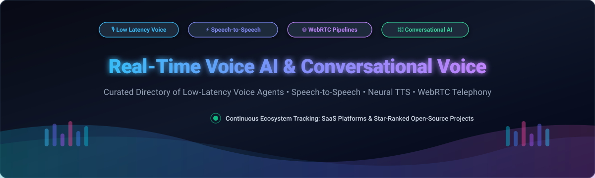

# Awesome Real-Time Voice AI & Conversational Voice 🎙️⚡

  

  
  
  
  
  
  

---

## 🌟 Overview & SEO Summary

Welcome to the definitive, curated index of **Real-Time Voice AI**, **Conversational Voice Agents**, **Speech-to-Speech (S2S) Models**, and **Low-Latency Telephony / WebRTC Frameworks**. Whether you are building human-like inbound/outbound phone assistants, full-duplex interactive voice AI agents, real-time speech recognition (ASR/STT) pipelines, or expressive zero-shot streaming neural text-to-speech (TTS), this guide tracks the industry-leading hosted SaaS platforms and highest-starred open-source engines.

---

## 📑 Table of Contents
- [📊 Sector Overview & Market Dynamics](#-sector-overview--market-dynamics)
- [🏢 SaaS & Hosted Platforms](#-saashosted-platforms)
- [💻 Open-Source GitHub Projects](#-open-source-github-projects)
- [📈 Star History](#-star-history)
- [💖 Support & Sponsorship](#-support--sponsorship)
- [🤝 How to Contribute](#-how-to-contribute)
- [⚖️ Disclaimer](#️-disclaimer)

---

## 📊 Sector Overview & Market Dynamics

The global conversational AI and real-time voice AI market represents one of the fastest-growing sectors in artificial intelligence, expanding from approximately **$12.8 billion in 2024** to an estimated **$18 billion – $24 billion by 2026** at an aggressive CAGR of **~24% to 38%** in dedicated voice-agent infrastructure. 

The sector exhibits **high fragmentation across the technical stack**: rather than a single winner-take-all monopoly, the ecosystem is distributed across foundational speech-to-speech foundation models (OpenAI, Kyutai), specialized high-fidelity voice synthesis and cloning vendors (ElevenLabs, Cartesia), ultra-low-latency transcription layers (Deepgram Nova), real-time WebRTC/SIP transport backbones (LiveKit, Daily.co), and turnkey voice agent orchestration platforms (Vapi, Retell AI, Bland AI).

---

## 🏢 SaaS & Hosted Platforms

Below is a comparison of premier hosted voice AI platforms, sorted in descending order by company scale, valuation, and capital raised.

| Platform | Company Size & Valuation / Funding | Starting Paid Pricing | Free Tier Limits / Free Trial | Description |
| :--- | :--- | :--- | :--- | :--- |
| **[ElevenLabs](https://elevenlabs.io)** | **$22.0B Valuation** (~$600M ARR; $781M+ raised) | **$5.00 / mo** (Starter tier; $0.08/min overage) | **15 minutes / mo** for conversational voice agents & 10,000 TTS chars/mo (Free forever, non-commercial, 4 concurrent calls) | End-to-end real-time voice agent platform combining ultra-realistic low-latency streaming TTS, conversational turn-taking, and LLM reasoning. |
| **[Deepgram](https://deepgram.com)** | **$1.3B Valuation** ($100M+ ARR; $229M raised) | **Pay As You Go** ($0.0043/min batch STT, $0.0077/min streaming STT, $0.075/min Voice Agent API) | **$200 in free credits** (Never expires, no credit card required, up to 150 concurrent STT streams) | High-speed real-time speech-to-text (Nova-3), neural text-to-speech (Aura-2), and unified Voice Agent API engineered for sub-second latency. |
| **[LiveKit Cloud](https://livekit.io)** | **$1.0B Valuation** (Unicorn Series C; $181M raised) | **Pay As You Go** ($0.004/video min, $0.00099/audio min after free tier) | **1,000 agent session mins/mo**, 5,000 WebRTC participant mins/mo, $2.50 inference credit, 100 concurrent users (Free forever Build plan) | Global edge WebRTC network and cloud bot deployment platform powering real-time voice and multimodal AI agents. |
| **[Vapi.ai](https://vapi.ai)** | **$500M Valuation** ($75M raised) | **$0.05 / min** platform orchestration fee (or Core Support package at $29/mo) | **$5.00 free credit** (~50–60 free minutes depending on stack, 4 concurrent calls, 1 included phone number) | Developer-centric voice AI orchestration platform for building, testing, and deploying low-latency phone and web voice agents at scale. |
| **[Bland AI](https://bland.ai)** | **$350M–$500M Valuation** ($100M+ raised) | **$0.14 / min** connected conversation (Build Plan at $299/mo lowers rate to $0.12/min) | **2 free trial credits** + 1 free inbound phone number (No credit card required, capped at 10 concurrent calls & 100 calls/day) | Ultra-realistic AI phone calling infrastructure designed for high-throughput enterprise inbound and outbound voice workflows. |
| **[Retell AI](https://retellai.com)** | **$100M ARR** ($5.1M raised; highly capital-efficient) | **$0.055 / min** core platform fee (Total all-in typical rate ~$0.07–$0.20/min) | **$10.00 in free credits** (~60–100 free call minutes depending on model, 20 concurrent calls, 10 knowledge bases) | Enterprise conversational voice AI platform specializing in natural turn-taking, telephony SIP integration, and high-concurrency call agents. |
| **[Hume AI](https://hume.ai)** | **$250M–$500M Valuation** ($80M+ raised) | **$3.00 / mo** (Starter tier; $0.07/min for Empathic Voice Interface) | **5 minutes / mo** for Empathic Voice Interface (EVI) & 10,000 TTS characters/mo (Free forever plan, 1 concurrent connection, 15 RPM) | Emotionally intelligent speech-to-speech API capable of detecting vocal prosody and responding with nuanced tone, expression, and empathy. |
| **[Daily.co](https://daily.co)** | **$160M Valuation** ($65M raised) | **Pay As You Go** ($0.00099/audio participant-min, $0.004/video participant-min after free tier) | **10,000 participant-minutes / mo** (Free forever, no credit card required, includes HD audio/video and SDK access) | Real-time WebRTC audio/video infrastructure and cloud bot hosting powering Pipecat conversational voice pipelines. |
| **[Tavus](https://tavus.io)** | **$120M+ Valuation** ($64M raised) | **$59.00 / mo** (Starter tier including 100 conversational video mins and 3 custom replica trainings) | **25 minutes / mo** of Conversational Video/Voice Interface (CVI) + 5 min video gen + stock replicas (Free forever Basic plan) | Real-time conversational video and voice avatar platform rendering expressive, low-latency digital human replicas with natural speech. |
| **[PlayHT (PlayAI)](https://play.ht)** | **Acquired by Meta** ($26M raised prior to acquisition) | **$31.20 / mo** (Creator tier; or Pay As You Go developer API rates) | **1,000 to 5,000 characters / mo** for studio testing (Free forever plan, non-commercial attribution required) | Ultra-low-latency conversational voice synthesis and agent platform offering instant voice cloning and multilingual streaming. |

---

## 💻 Open-Source GitHub Projects

The open-source voice AI ecosystem has exploded with self-hosted speech-to-speech models, fast neural TTS engines, streaming Whisper ASR implementations, and flexible WebRTC agent frameworks. 

Below are the premier open-source voice AI projects, **sorted strictly in descending order by GitHub Stars_Counts**. Click any Stars_Badge to inspect the stargazer community!

- **[VoiceStudio](https://github.com/debpalash/VoiceStudio)**   
  All-in-one desktop AI voice studio integrating leading TTS models, voice cloning engines, and batch audio generation.

- **[Real-Time Voice Cloning](https://github.com/CorentinJ/Real-Time-Voice-Cloning)**   
  Pioneering deep learning framework for zero-shot multi-speaker text-to-speech voice cloning from 5 seconds of audio.

- **[whisper.cpp](https://github.com/ggerganov/whisper.cpp)**   
  High-performance inference of OpenAI Whisper model in C/C++ without external dependencies, optimized for Apple Silicon, CPU, and edge devices.

- **[Coqui TTS](https://github.com/coqui-ai/TTS)**   
  Deep learning toolkit for Text-to-Speech featuring XTTS-v2, VITS, YourTTS, and multilingual speech generation across 17+ languages.

- **[ChatTTS](https://github.com/2noise/ChatTTS)**   
  Conversational generative speech model designed specifically for dialogue scenarios, conversational agents, laughter, and natural interjections.

- **[Bark](https://github.com/suno-ai/bark)**   
  Transformer-based text-to-audio model by Suno capable of generating expressive speech, background noise, music, and sound effects.

- **[RVC](https://github.com/RVC-Project/Retrieval-based-Voice-Conversion-WebUI)**   
  Voice conversion framework based on VITS with web UI for low-latency, high-fidelity real-time voice transformation.

- **[OpenVoice](https://github.com/myshell-ai/OpenVoice)**   
  Instant voice cloning requiring only a short audio clip to replicate voice tone and color with flexible control over emotion, accent, and rhythm.

- **[Fish Speech](https://github.com/fishaudio/fish-speech)**   
  Open-source zero-shot multilingual TTS and voice cloning engine engineered for low-latency streaming conversational applications.

- **[Chatterbox](https://github.com/resemble-ai/chatterbox)**   
  Open-weights emotion-controlled voice synthesis and expressive conversational TTS developed by Resemble AI.

- **[faster-whisper](https://github.com/SYSTRAN/faster-whisper)**   
  Faster Whisper transcription with CTranslate2 up to 4x faster than openai/whisper with reduced memory footprint.

- **[CosyVoice](https://github.com/FunAudioLLM/CosyVoice)**   
  Multi-lingual large voice generation model supporting zero-shot cloning, cross-lingual synthesis, and streaming inference by Alibaba.

- **[Pipecat](https://github.com/pipecat-ai/pipecat)**   
  Vendor-neutral open-source Python framework for voice and multimodal conversational AI agents over WebRTC and WebSockets.

- **[F5-TTS](https://github.com/SWivid/F5-TTS)**   
  Non-autoregressive speech synthesis system using flow matching for ultra-fast, natural zero-shot voice cloning.

- **[LiveKit Agents](https://github.com/livekit/agents)**   
  Framework for building programmable real-time voice and multimodal AI agents with built-in turn detection, VAD, and SIP telephony bridges.

- **[Moshi](https://github.com/kyutai-labs/moshi)**   
  Open-source full-duplex speech-to-speech foundation model by Kyutai capable of listening and speaking simultaneously with sub-200ms latency.

- **[Piper TTS](https://github.com/rhasspy/piper)**   
  Fast, local neural text-to-speech system optimized for Raspberry Pi, edge devices, and ultra-low latency.

- **[TEN Agent](https://github.com/TEN-framework/TEN-Agent)**   
  Conversational AI agent framework integrating voice, vision, and real-time multimodal interaction with graph orchestration.

- **[Silero VAD](https://github.com/snakers4/silero-vad)**   
  Enterprise-grade, lightweight Voice Activity Detector (VAD) essential for speech segmentation, turn-taking, and barge-in interruption.

- **[Kokoro](https://github.com/hexgrad/kokoro)**   
  Lightweight 82M-parameter neural TTS model delivering studio-grade speech synthesis faster than real-time on CPU and GPU.

- **[RealtimeSTT](https://github.com/KoljaB/RealtimeSTT)**   
  Fast, low-latency speech-to-text library providing real-time voice activity detection, microphone capture, and continuous transcription.

- **[Orpheus TTS](https://github.com/canopyai/Orpheus-TTS)**   
  Expressive open-source emotional text-to-speech system designed for dialogue scenarios and interactive voice conversation.

- **[Ultravox](https://github.com/Fixie-AI/ultravox)**   
  Fast, open-weights multimodal speech LLM by Fixie.ai that directly ingests audio tokens without an ASR text bottleneck.

- **[WhisperLive](https://github.com/collabora/WhisperLive)**   
  Near-live speech-to-text streaming server built on Faster-Whisper for real-time microphone and WebSocket audio streams.

- **[RealtimeTTS](https://github.com/KoljaB/RealtimeTTS)**   
  Real-time text-to-speech library with low-latency streaming audio playback tailored for conversational AI agents.

- **[Vocode](https://github.com/vocodedev/vocode-python)**   
  Open-source library for building voice-based LLM agents across phone calls, Zoom meetings, and web audio streams.

- **[openWakeWord](https://github.com/dscripka/openWakeWord)**   
  Lightweight open-source custom wake-word detection engine running efficiently on edge hardware, microcontrollers, and standard CPUs.

- **[Bolna](https://github.com/bolna-ai/bolna)**   
  Conversational voice AI framework tailored for telephony agents, multilingual Indic and global languages, and low-latency streaming.

- **[Wyoming Protocol](https://github.com/rhasspy/wyoming)**   
  Open-source peer-to-peer protocol connecting local wake-word detectors, STT, and TTS services into private voice assistants for Home Assistant.

- **[GPT-SoVITS](https://github.com/RVC-Boss/GPT-SoVITS)**   
  Powerful few-shot voice cloning and text-to-speech web studio capable of zero-shot TTS from a 5-second audio sample or custom fine-tuning.

---

## 📈 Star History

---

## 💖 Support & Sponsorship

Thank you so much for exploring and using this resource! 🙏 If you find this repository valuable for your research, projects, or enterprise voice infrastructure, please consider showing your support:

- ⭐ **Star this repository** to help others discover it.
- 🍴 **Fork the repository** to build and customize your own voice AI pipelines.
- 📢 **Share with your colleagues, community, and social networks**.
- ☕ **Buy me a coffee / Sponsor the project**: Contributions directly fuel continuous research, testing, and maintenance of developer resources. You can support via the [GitHub Sponsors Dashboard](https://github.com/sponsors/ishandutta2007).

---

## 🤝 How to Contribute

We welcome contributions from researchers, voice AI developers, and the open-source community! 

1. 🍴 Fork the repository.
2. 📝 Add or update an entry in `README.md` (keep descriptions factual, concise, and linked to official repositories or sites).
3. 💬 Open a Pull Request with a clear description of the project and why it belongs in the ecosystem.

---

## ⚖️ Disclaimer

- This repository is a **community-curated index** for informational, technical, and educational purposes. Inclusion does not imply endorsement.
- Automated outbound telephony and call recording are subject to national and international telecommunications regulations (e.g., TCPA, FCC, TRAI DND, GDPR, HIPAA); always ensure regulatory compliance and proper user consent.
- Voice cloning and synthetic audio technologies must always be deployed ethically and with explicit authorization from the voice owner.

---

  <b>Built with ❤️ for voice AI engineers, WebRTC developers, telephony architects, and open-source pioneers worldwide.</b>

